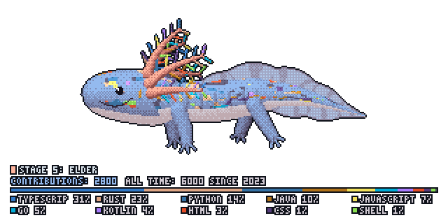
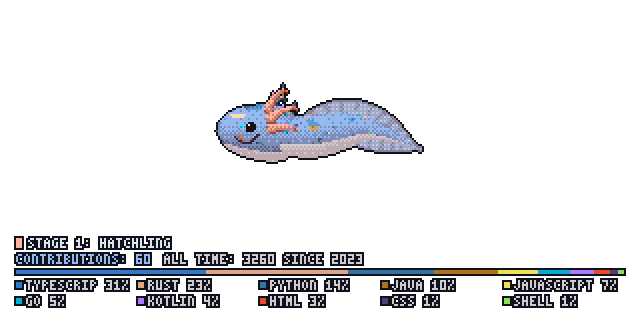
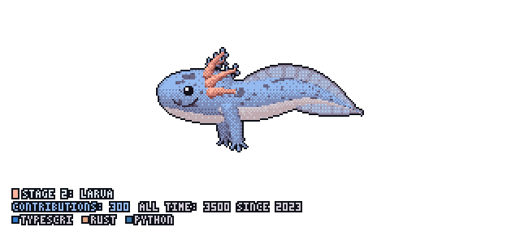
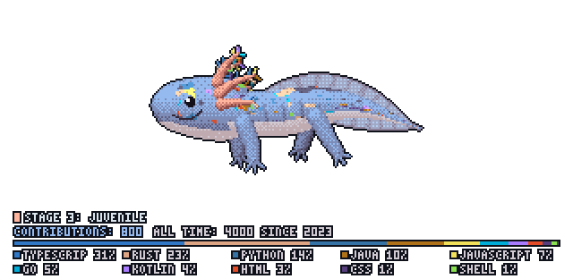
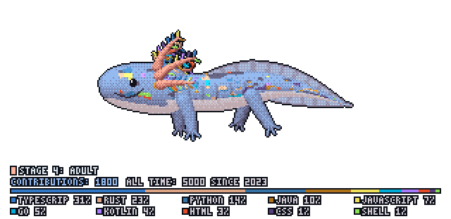
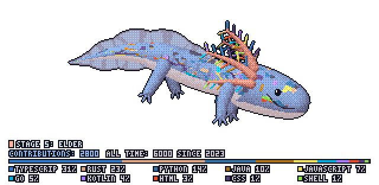
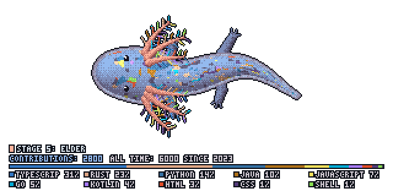
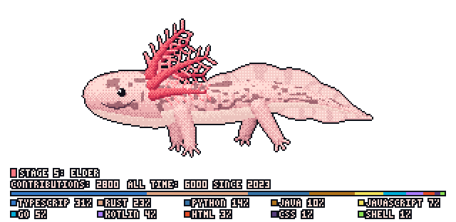

# git-axolotl

A procedural pixel-art axolotl for your GitHub profile `README.md`. It grows from a legless hatchling into an elder with a full gill crown as you contribute, wears the colors of your top 10 languages, and gets a spot pattern unique to your account.

<p align="center">
  
</p>

## Quick start

**1.** Add this to your profile `README.md`, replacing `YOUR_USERNAME`:

```markdown
<p align="center">
  <a href="https://github.com/neonjava/git-axolotl">
    
  </a>
</p>
```

**2.** Create `.github/workflows/axolotl.yml` in the same repository:

```yaml
name: Update Axolotl

on:
  schedule: [{ cron: "0 0 * * *" }]
  workflow_dispatch:
  push: { branches: [main] }

permissions:
  contents: write

jobs:
  axolotl:
    runs-on: ubuntu-latest
    steps:
      - uses: neonjava/git-axolotl@v2
        with:
          view: side     # side | dive | top
          window: annual # annual | rolling | all
```

The action pushes `axolotl.gif`, `axolotl.png` and `share-card.png` to an orphan `output` branch, so daily updates never bloat your `main` history.

## Stages

Growth follows real axolotl development. Each stage adds anatomy instead of only getting bigger.

| Stage | Contributions | Preview | What changes |
| :--- | :---: | :---: | :--- |
| **1: Hatchling** | `0 – 149` |  | Big head, short gills, no legs. |
| **2: Larva** | `150 – 499` |  | Front legs appear. |
| **3: Juvenile** | `500 – 1,199` |  | Back legs appear and spots spread. |
| **4: Adult** | `1,200 – 2,499` |  | Longer body, fuller gills, flank grooves. |
| **5: Elder** | `2,500+` |  | Full gill crown and a frilled tail fin. |

## Contribution windows

`window` decides which total drives growth:

| Value | Counts | Resets |
| :--- | :--- | :--- |
| `annual` | The current calendar year | Every January 1st |
| `rolling` | The trailing 365 days | Never, but old days drop off |
| `all` | Every year since your first contribution | Never |

Whichever you choose, the HUD also shows your all-time history, such as `ALL TIME: 5754 SINCE 2025`. It is added up from each year in your GitHub contribution graph.

## Private contributions

GitHub only reveals private contributions as anonymous counts. Repository names and details are never exposed.

- **Your own, the easy way:** turn on **Private contributions** under *Contribution settings* on your GitHub profile. The default token then counts them.
- **Your own, without showing them on your profile:** create a personal access token with the `repo` and `read:user` scopes, save it as a repository secret, and pass it in:

  ```yaml
  - uses: neonjava/git-axolotl@v2
    with:
      token: ${{ secrets.AXOLOTL_TOKEN }}
  ```

- **Other people's:** counted only if they turned on that same setting. Nothing can read them otherwise.

Languages always come from public repositories, so a personal token cannot reveal private repository languages in your public GIF.

Without a token or `gh`, languages are counted per repository instead of by bytes, as are the ones in the web preview.

## Camera views

| `view` | Preview | Description |
| :--- | :---: | :--- |
| `side` (default) |  | Profile with the smile, gills and fin. |
| `dive` |  | Head-down dive, facing right. |
| `top` |  | Gills and legs spread on both sides. |

## Colors

Your top 10 languages are ranked by bytes of code across your public, non-fork repositories, like the language bar on a GitHub repository. Below the axolotl, the HUD shows a colored share bar and a legend with each language's percentage.

All 10 also appear on the axolotl:

- **Language 1:** skin, belly tint and fin.
- **Language 2:** gill stalks.
- **Every language:** the feathery gill fronds cycle through them, and the spots use them in proportion to their share, softened so small languages stay visible.

Younger stages have fewer fronds and spots, so more of your languages appear as the axolotl grows.

Set `natural: "true"` (or `--natural` on the CLI) for the classic pink axolotl:

<p align="center">
  
</p>

## Action inputs

| Input | Default | Description |
| :--- | :--- | :--- |
| `login` | `${{ github.repository_owner }}` | GitHub username to draw. |
| `view` | `side` | `side`, `dive` or `top`. |
| `window` | `annual` | `annual`, `rolling` or `all`. |
| `natural` | `"false"` | Use natural pink colors instead of language colors. |
| `output-dir` | `axolotl` | Output directory. |
| `commit` | `"true"` | Commit and push the generated images. |
| `branch` | `output` | Target branch. The action refuses to overwrite a branch it did not create. |
| `token` | `${{ github.token }}` | Token for reading data and pushing. |

If data can't be fetched, the run fails and leaves your last good image in place.

## CLI

```bash
cargo install --git https://github.com/neonjava/git-axolotl

# Collect a snapshot (uses GITHUB_TOKEN, GH_TOKEN or the gh CLI when available)
git-axolotl collect <GITHUB_USERNAME> --window all --output snapshot.json

# Render axolotl.gif, axolotl.png, share-card.png and preview.html
git-axolotl render snapshot.json --output-dir axolotl --view side

# Preview any contribution count without GitHub
git-axolotl demo --commits 800 --output-dir axolotl-demo
```

Without a token or `gh`, collection falls back to public endpoints, including the third-party `github-contributions-api.jogruber.de` service.

## Credits and license

Forked from [git-tulkun](https://github.com/PramudithaN/git-tulkun) by Pramuditha Nadun. MIT licensed, see [LICENSE](LICENSE).
